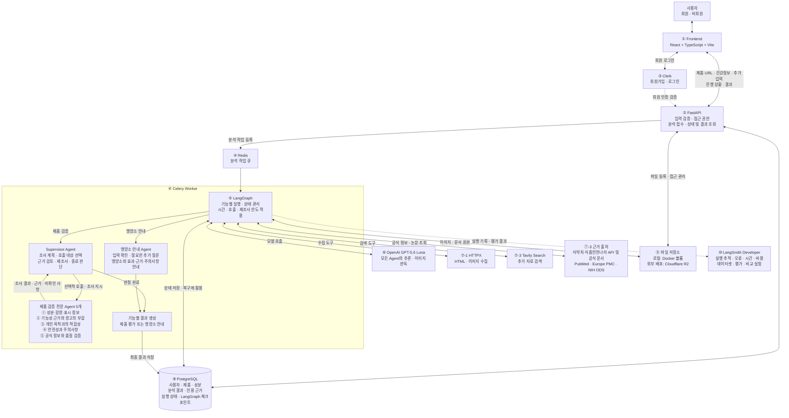

# 합의한 전체 아키텍처

> 설계 확정 당시 기록의 사본이다. 현재 구현 상태는 `handoff.md`와 실제 코드를 확인한다.

저장일: 2026-11-07 (Asia/Seoul)
사용자 요청: “저 이미지 메모리에 저장해줘”
범위: 직전 답변의 전체 아키텍처 다이어그램, 이를 설명하는 확정 기술과 배포 방향.
이 파일은 작업공간의 참조 메모리이며, 계정 전역 메모리에 저장했다는 의미는 아니다.
현재 상태는 대화로 합의한 설계다. 이 요청으로 애플리케이션 구현·계정 생성·배포를 시작하지 않았다.

## 전체 아키텍처

직전 답변의 Mermaid 다이어그램 원본을 아래에 보존한다.
별도 원본 파일: [architecture.mmd](./architecture.mmd)

## 확정한 초기 기술

| 번호 | 영역 | 결정 |
|---|---|---|
| ① | Frontend | React + TypeScript + Vite |
| ② | Backend API | FastAPI |
| ③ | 회원가입·인증 | Clerk 무료 플랜으로 시작 |
| ④ | 작업 전달·실행 | Celery + Redis |
| ⑤ | Agent 프레임워크 | LangGraph |
| ⑥ | LLM | OpenAI GPT-5.6 Luna로 시작 |
| ⑦-1 | URL 수집 | HTTPX |
| ⑦-2 | 이미지·성분표 판독 | GPT-5.6 Luna 직접 판독 |
| ⑦-3 | 일반 웹 검색 | Tavily Search 무료 플랜으로 시작 |
| ⑦-3 | 근거 출처 | 식약처·식품안전나라 API, 식약처 공전·기능성 원료 인정자료, PubMed, Europe PMC, NIH ODS 모두 활용 대상 |
| ⑧ | DB | PostgreSQL |
| ⑨ | 파일 저장소 | 로컬 Docker 볼륨 / 외부 배포 시 Cloudflare R2 |
| ⑩ | 관측·평가 | LangSmith Developer 무료 범위로 시작 |
| ⑪ | 개발·운영 실습 | Docker + Docker Compose / 로컬 Kubernetes는 kind |

기술 후보를 비교하며 언급했던 Beautiful Soup·Playwright·다른 모델·다른 인증 서비스 등을 확정 기술로 자동 추가하지 않는다.
관리형 DB 제공사, 외부 클라우드 제공사·서버 크기, CI/CD·이미지 레지스트리 등의 세부 선택은 이 기록에서 확정하지 않았다.

## 역할과 연결 해석

- Frontend·API·Worker가 애플리케이션의 주요 배포 단위다.
- Supervisor 1개, 제품 검증 전문 역할 5개, 영양소 안내 역할 1개로 총 7개 논리 역할이다.
- 전문 Agent들은 Worker 내부에서 실행한다. 역할별 독립 서버나 컨테이너를 요구하지 않는다.
- Supervisor는 필요한 전문 Agent를 선택하고 조사 지시·근거 검토·필요한 재조사·종료 판단을 한다.
- 각 Agent는 맡은 조사 안에서 필요한 도구와 출처를 선택한다. 모든 출처를 매번 호출하지 않는다.
- 고정 전문 역할을 사용하며, 실행 중 Agent 생성·복제는 제외한다.
- Celery·Redis는 분석 작업의 전달·실행을 담당한다.
- LangGraph는 분석 내부의 상태·분기·반복과 체크포인트를 관리한다.
- 재시작 후 복구는 Celery 재처리와 영속 체크포인트를 연결해 구현해야 한다. 도구 도입만으로 복구가 완료된 상태는 아니다.
- PostgreSQL에 서비스 데이터·인용 근거·실행 상태를, 파일 저장소에 이미지·문서 원본을 보관한다.
- Clerk는 인증을 담당하고, FastAPI는 회원 인증과 사용자별 데이터 접근 권한을 확인한다.
- 사용자 업로드 파일은 비공개로 저장하며, 접근 권한 확인 후 필요한 접근 경로를 제공하는 방향이다.
- LangSmith는 실행 추적과 개발용 평가·비교 실험을 담당한다. 서비스의 제품 평가 점수와 개발용 품질 평가는 구분한다.

## 두 사용자 흐름

1. 비회원: 제품 URL 제출 → 공통 제품 검증. 개인 적합성은 미평가로 표시한다.
2. 회원: 건강정보 기반 영양소 안내 또는 관심 제품 검증·개인 적합성 확인 → 결과 저장.
3. 영양소 안내는 고려할 영양소·효과·근거·주의사항을 제공하며 제품 후보를 제시하지 않는다.
4. 식생활 문진은 제외한다. 건강검진 수치는 선택 입력이다.
5. 제품 수집·판독이 부족하면 이전에 합의한 추가 입력·수동 성분 입력 흐름을 사용한다.

## 배포 환경

| 환경 | 방향 |
|---|---|
| 기본 개발 | Docker Compose로 Frontend·FastAPI·Worker·Redis·PostgreSQL 실행, 파일은 Docker 볼륨 |
| Kubernetes 실습 | kind에서 배포 업데이트·Worker 복구·Replica 조절·처리량 비교 |
| 외부 배포 확장 | 필요 시 클라우드 단일 서버·K3s·관리형 Kubernetes 등을 검토, 파일은 R2 |

Clerk·OpenAI·Tavily·LangSmith 등은 외부 서비스다.
상시 클라우드 Kubernetes 운영을 초기 필수 조건으로 확정한 것은 아니다.

## 보완·확장 항목

- Frontend: 필요가 생기면 Next.js 전환 검토.
- LLM: Luna를 기준으로 모델 업그레이드 및 역할별 모델 배정 비교 실험.
- 이미지 판독: Luna 단독과 CLOVA OCR + Luna 조합의 정확도·누락률·시간·비용 비교.
- URL 수집: 대표 URL 수집률·필수 정보 누락률 평가. JavaScript 실행이 필요한 페이지 수집은 추후 보완.
- RAG 챗봇: 추가 시 PostgreSQL의 pgvector 활용. 현재 임베딩·벡터 검색을 구현한 상태는 아니다.
- 근거 자료: 출처 URL·문서 식별자·수집일·버전 정보를 보존한다.
- PubMed와 Europe PMC의 동일 논문은 중복 근거로 세지 않는다.

## 미검증 범위

- 공식 API 문서·출처 검토와 실제 인증키 연동·성공 응답 확인은 구분한다.
- 제품 매칭 정확도, 원료·GMP·회수·수입 제품 자료의 자동 조회 범위는 구현 중 검증해야 한다.
- 포괄적인 약물–영양제 상호작용 데이터베이스를 확보했다고 가정하지 않는다.
- 실제 사례의 모델·이미지 판독 품질, 비용, 처리량·복구 성능을 측정한 상태는 아니다.
- API 명세·DB 테이블·Agent 입출력 등 구체적인 구현 명세는 후속 작업이다.

## 이전 기록과의 관계

`기획_대화_메모리_2026-11-05.md`(원본 작업공간의 이전 기록)는 재기획 시작 시점의 역사 기록이다.
현재 아키텍처·기술 선택에는 이 2026-11-07 기록을 우선 참고한다.
이 파일은 이후 대화 전체의 기획 세부사항을 빠짐없이 옮긴 전체 기획서가 아니라, 요청한 전체 아키텍처를 보존한 기록이다.
